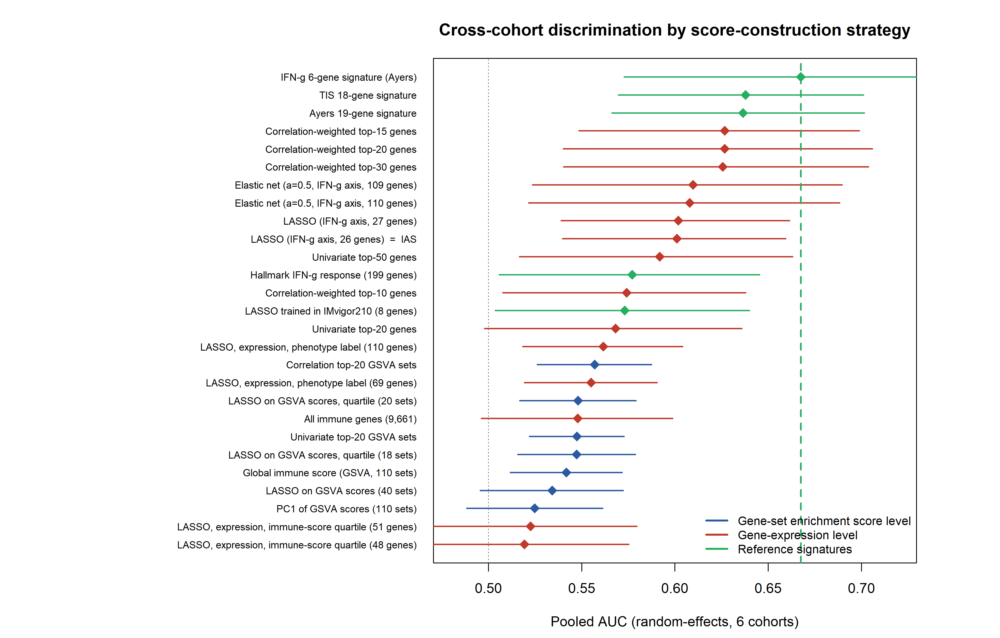

# Benchmarking transcriptomic immune signatures for ICI response

Analysis code and derived results for:

> **Expression-level immune signatures outperform gene-set enrichment scores for
> predicting immune checkpoint inhibitor response: a cross-cohort benchmark in
> 591 patients**
> Yanguang Zhao, Hong Jiang, Jing Yao, Qilan Ma, Jingyi Yu, Yungang He, Yulian Zhang and Xi Tang
> Department of Head and Neck Oncology, Chongqing University Cancer Hospital



---

## What this repository contains

A head-to-head benchmark of **27 strategies for constructing a transcriptomic
immune score**, evaluated under one fixed scoring, discrimination and pooling
procedure across **six independent ICI-treated cohorts (591 patients, 127
responders)**, with TCGA-HNSC (520 primary tumours, 221 death events) as the
discovery cohort.

The central and reproducible finding is that **how a score aggregates
expression matters more than how many genes it uses**:

| Aggregation level | Pooled AUC range | n strategies |
|---|---|---|
| Gene expression | **0.519 – 0.668** | 19 |
| Published reference / trained | 0.573 | 1 |
| Gene-set enrichment score (GSVA / ssGSEA) | **0.525 – 0.557** | 7 |

Every strategy built from gene-level expression outranks every strategy built
from a gene-set enrichment statistic. The most plausible mechanism is that
GSVA and ssGSEA are *within-sample rank-based* statistics: they discard the
absolute abundance of immune transcripts, which is itself informative.

A second, methodological finding concerns the derivation step. When the
phenotype label is the median split of the very features used to fit the model,
training discrimination is 1.0 by construction. Replacing the label with an
independent IFN-gamma anchor, and separating fitting from evaluation with a
70/30 stratified split, removes this circularity — and the resulting score
performs *worse* than a six-gene published signature, which is the honest
result we report.

## Repository layout

```
ici-benchmark/
├── scripts/            分析代码（按执行顺序编号）
│   ├── 00_config.R         路径与共享函数（所有脚本的唯一入口）
│   ├── download_data.sh    抓取全部公开输入数据
│   ├── ncbi_geo.sh         NCBI/GEO 访问（FTP / IP 直连双通道）
│   ├── run_all.sh          顺序执行整条管线
│   ├── 01_prep.R           队列与表达矩阵
│   ├── 02_discovery.R      TCGA-HNSC 免疫表型 + 派生分数
│   ├── exp_ias*.R          4 组探索实验（定义 27 个策略）
│   ├── 04_markers.R        免疫细胞标记基因面板
│   ├── 06_final.R          跨队列验证（主结果）
│   ├── 07_figures_extra.R  fig6 / fig7
│   ├── 08_jtm_tables.R     稿件 Table 1-2
│   └── 09_benchmark_table.R 27 方案基准总表（Table 4）
├── data/               原始数据（不纳入版本控制，见 data/README.md）
├── results/
│   ├── tables/         派生表（CSV）
│   ├── figures/        派生图（PNG, 300 dpi）
│   └── rds/            中间对象（仅提交小体积者）
└── docs/
    ├── DATA_SOURCES.md 每个数据的出处、accession、已知坑
    ├── PIPELINE.md     各脚本做什么、为什么这样做
    └── SESSION_INFO.txt 软件与包版本
```

## Quick start

```bash
git clone <repository-url>
cd ici-benchmark

# 1. 原始数据（约 420 MB）
bash scripts/download_data.sh

# 2. 依赖
Rscript -e 'install.packages(c("data.table","matrixStats","glmnet","pROC","metafor","survival","openxlsx","msigdbr"))'
Rscript -e 'BiocManager::install(c("GSVA","ConsensusClusterPlus","BiocParallel"))'

# 3. 跑管线
export ICI_WORK="$(pwd)"
bash scripts/run_all.sh
```

Scripts resolve all paths through `scripts/00_config.R`, so they can be run from
any working directory:

* `ICI_WORK` — repository root (default: current working directory)
* `ICI_LIB` — optional extra R library directory (default: `<root>/Rlib` if present)

Run a single stage with `Rscript scripts/06_final.R`, or resume the chain from a
given stage with `bash scripts/run_all.sh 06`.

## Data availability

No new data were generated. All inputs are public; see
**[docs/DATA_SOURCES.md](docs/DATA_SOURCES.md)** for accessions, download URLs
and platform-specific pitfalls. In brief:

* **Discovery** — TCGA-HNSC via the UCSC Xena / GDC harmonised hub.
* **Validation** — GEO GSE159067, GSE176307, GSE91061, GSE78220, GSE135222, and
  IMvigor210 (IMvigor210CoreBiologies, CC-BY 3.0; sequencing data at EGA under
  **EGAS00001002556**).
* **Gene sets** — MSigDB 2024.1.Hs (Hallmark, C7) and NCBI Gene annotation.

Raw data are deliberately **not** redistributed here: several of these sources
have their own licences and terms of use, and the download script retrieves them
from the original archives.

## Reproducibility status

`09_benchmark_table.R` and `08_jtm_tables.R` were re-run from a clean checkout
layout against the frozen intermediates and produced output **identical in
content** to the CSVs in `results/tables/`. (The repository stores LF line
endings; R's `fwrite` emits CRLF on Windows, so the comparison is made after
line-ending normalisation — `.gitattributes` enforces this.) Stages 1-6 contain
long-running computations (GSVA over 110 gene sets, 1000-replicate consensus
clustering, a 200-permutation test) and were executed once; their outputs are
archived in `results/`. Every quantitative value in the manuscript traces to a
file in `results/tables/` — no value was entered by hand.

## Two things worth knowing before you re-run this

**GSVA, not ssGSEA, for the discovery step.** With ssGSEA the median
between-sample Spearman correlation of the enrichment matrix is roughly 0.93,
and consensus clustering degenerates to 517/3 no matter what. With GSVA the same
correlation is roughly 0, and k = 2 returns a balanced 251/269 split. This is a
property of the statistic, not of the data — see `docs/PIPELINE.md`.

**Signature-matrix deconvolution was tried and rejected.** CIBERSORT with LM22
either failed to converge (over three minutes per sample under the published
`scale = FALSE` parameterisation) or returned degenerate solutions in which two
of twenty-two lineages absorbed nearly all of the weight. LM22 is highly
co-linear and not quantile-normalised, so a convex combination cannot
approximate bulk head and neck tumour profiles. `04_markers.R` uses a validated
marker-gene panel (Danaher et al.) instead. No script here depends on
CIBERSORT or LM22.

## Licence

Code: MIT (see [LICENSE](LICENSE)).
Derived results in `results/`: CC BY 4.0.
Redistributed source data retain the licence of their original archive.

## Citation

See [CITATION.cff](CITATION.cff). If you use this code, please cite the
manuscript above; a Zenodo DOI will be added on release.
